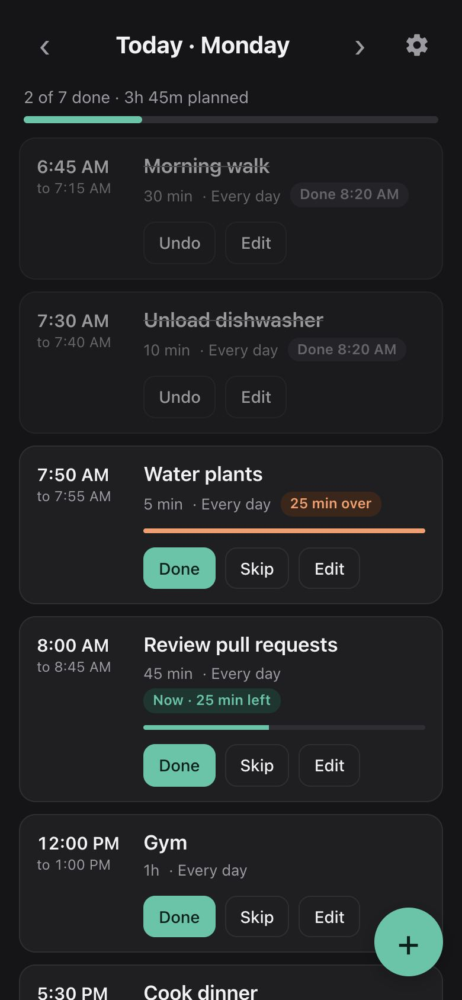
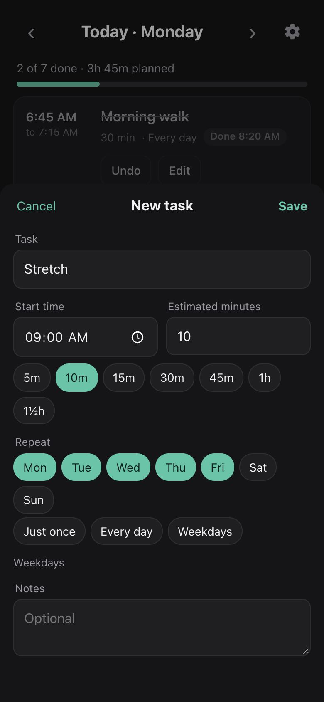

# Daily Tasks

A small task tracker you add to your iPhone Home Screen. Each task has a **start time** and an **estimated time to complete**. Your phone gets two kinds of push notifications:

- **"Time to start: Unload dishwasher"** at the task's start time.
- **"Did you finish Unload dishwasher?"** if it isn't marked done 10 minutes after its estimate runs out. It asks again every 30 minutes, at most 3 times. (All three numbers can be changed in `.env`.)

Tasks can be one-off (a single date) or repeat on chosen weekdays. Tapping a notification opens the app on that task so you can mark it **Done** or **Skip**.

| Today | New task |
| --- | --- |
|  |  |

It's one Node.js server plus a static web app. Data lives in a single JSON file (`data/db.json`). The only dependency is the `web-push` library. Caddy sits in front and handles HTTPS automatically.

## What you need

- Your Oracle Cloud server (Ubuntu or Oracle Linux; the Always Free shapes are plenty).
- A domain name pointing at the server's public IP. iPhone push only works over HTTPS, which needs a real hostname. If you don't own a domain, a free subdomain from [DuckDNS](https://www.duckdns.org) works: sign in, create `yourname.duckdns.org`, and set its IP to your server's public IP.
- iOS 16.4 or newer on the iPhone.

## Deploy on the Oracle server

### 1. Open ports 80 and 443

Oracle blocks these in two places.

**In the Oracle Cloud console:** Networking › Virtual Cloud Networks › your VCN › Security Lists › Default Security List › Add Ingress Rules. Add two rules with source CIDR `0.0.0.0/0`, IP protocol TCP, destination ports `80` and `443`.

**On the server itself:**

Ubuntu images:
```sh
sudo iptables -I INPUT 6 -m state --state NEW -p tcp --dport 80 -j ACCEPT
sudo iptables -I INPUT 6 -m state --state NEW -p tcp --dport 443 -j ACCEPT
sudo netfilter-persistent save
```

Oracle Linux images:
```sh
sudo firewall-cmd --permanent --add-service=http --add-service=https
sudo firewall-cmd --reload
```

### 2. Install Docker

Ubuntu:
```sh
curl -fsSL https://get.docker.com | sudo sh
sudo usermod -aG docker $USER   # then log out and back in
```

Oracle Linux:
```sh
sudo dnf install -y dnf-plugins-core
sudo dnf config-manager --add-repo https://download.docker.com/linux/centos/docker-ce.repo
sudo dnf install -y docker-ce docker-ce-cli containerd.io docker-compose-plugin
sudo systemctl enable --now docker
sudo usermod -aG docker $USER   # then log out and back in
```

### 3. Copy the app to the server

From the computer where you downloaded this folder:
```sh
scp -r daily-tasks-app ubuntu@YOUR_SERVER_IP:~/      # use opc@ on Oracle Linux
```

### 4. Configure it

On the server:
```sh
cd ~/daily-tasks-app
cp .env.example .env
nano .env
```
Set `DOMAIN`, a long `APP_PASSWORD`, your email in `VAPID_SUBJECT`, and your `TZ`.

### 5. Start it

```sh
docker compose up -d --build
docker compose logs -f      # Ctrl+C to stop watching
```
You should see `Daily Tasks listening on :3000 (timezone America/Chicago)` and Caddy reporting that it obtained a certificate. Both containers restart on their own after a reboot.

## Set up the iPhone

1. Open `https://YOUR_DOMAIN` in **Safari**.
2. Tap the **Share** button, then **Add to Home Screen**.
3. Open **Tasks** from the new Home Screen icon (notifications only work when opened this way, not in a Safari tab).
4. Sign in with your `APP_PASSWORD`.
5. Tap **Turn on notifications** and allow them.
6. Open settings (gear icon) and tap **Send a test notification**. It should arrive within a few seconds.

## Day to day

- **+** adds a task. Pick a start time, an estimate (or tap a chip like 15m), and either leave it as "Just once" for the day you're viewing or choose repeat days.
- **Done** / **Skip** marks today's occurrence. **Undo** reverses it. Repeating tasks reset each day.
- The arrows move between days so you can plan tomorrow.
- Editing a task's time re-arms today's reminders for it.

## Lock screen widget (optional)

Shows the task you should be doing now (or the next one) and how many are done, on the Lock Screen or Home Screen. It uses the free [Scriptable](https://apps.apple.com/app/scriptable/id1405459188) app.

1. Install Scriptable from the App Store.
2. In Daily Tasks, open Settings and tap **Copy widget link**.
3. In Scriptable, tap **+**, paste in the contents of `widget/daily-tasks-widget.js`, and replace `PASTE_YOUR_WIDGET_LINK_HERE` with the link you copied. Name the script "Daily Tasks".
4. Long-press the Lock Screen › **Customize** › Lock Screen › tap the widget area › **Scriptable**. Pick the wide rectangle (best fit), the circle (done count) or the line above the clock.
5. Tap the new widget while still customizing, set **Script** to "Daily Tasks", then tap Done.

iOS decides when widgets refresh. The script asks for a refresh at the next start or end time, but it can lag by several minutes, so the notifications stay the on-time signal. The widget link can only read today's tasks. Changing `APP_PASSWORD` changes the link, so copy it again afterward.

## Maintenance

- **Back up:** copy `~/daily-tasks-app/data/`. It holds your tasks and the push keys. If the keys are lost, the phone just needs to tap "Turn on notifications" again.
- **Update the app:** copy the new files over (keep `.env` and `data/`), then `docker compose up -d --build`.
- **Change the password:** edit `APP_PASSWORD` in `.env` and run `docker compose up -d`. You'll be asked to sign in again.

## Troubleshooting

- **Caddy can't get a certificate:** the domain doesn't point at the server yet, or port 80/443 is still blocked (check both places in step 1). `docker compose logs caddy` shows the reason.
- **No "Turn on notifications" button:** the app was opened in Safari instead of from the Home Screen icon.
- **Notifications were allowed but none arrive:** check iPhone Settings › Notifications › Tasks, and make sure Focus modes aren't hiding them. `docker compose logs app` shows any push errors.
- **Times are off by hours:** `TZ` in `.env` is wrong. Fix it and run `docker compose up -d`.

## Running without Docker

Node 18 or newer:
```sh
npm ci --omit=dev
APP_PASSWORD=... TZ=America/Chicago VAPID_SUBJECT=mailto:you@example.com node server.js
```
It listens on port 3000 over plain HTTP, so put it behind an HTTPS reverse proxy (Caddy, nginx) for the iPhone. The proxy must send `X-Forwarded-Proto`.

## License

MIT. See [LICENSE](LICENSE).
